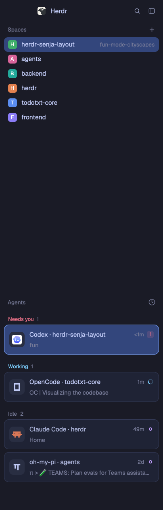
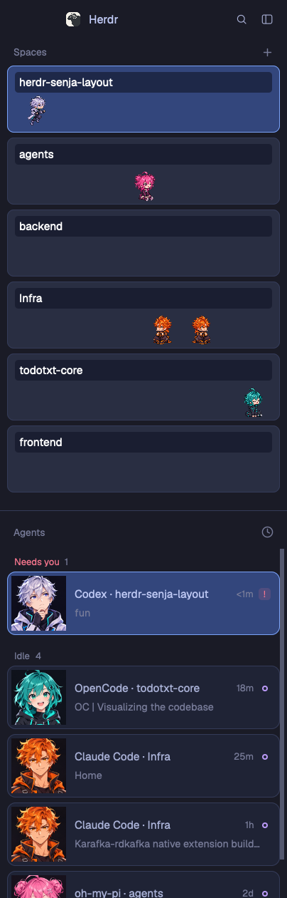

# herdr-senja-layout

My [Herdr](https://herdr.dev) setup, kept as a shareable layout folder.


## Professional and Fun modes

Press **Cmd + Ctrl + G** while the Agents panel is visible to switch modes. Herdr remembers your choice across restarts.

| Professional mode | Fun mode |
| --- | --- |
|  |  |

Professional mode uses the standard harness icons and compact space list. Under each space's name it shows one small icon per agent harness with a session in that space (wrapping when there are many), faded when all of that harness's agents are idle. Fun mode adds anime portraits to supported agent cards and larger space cards with pixel-art chibi characters. Each agent session has its own animated pixel-art chibi: it runs back and forth while working, jumps in place when it needs attention or has finished, and sits and blinks when idle. Agent cards show the harness and space name in both modes. Unknown harnesses keep their usual icons.

The narrow sidebar stays compact in both modes.

```
RECIPE.md          the brief: build Senja from an empty folder
preview.png        layout screenshot
fun-mode.png       Fun mode sidebar
professional-mode.png  Professional mode sidebar
layouts/senja.json the layout (+ senja.png, its settings-screen preview)
mods/              every non-shipped mod the layout uses
themes/            tokyo-night.json
keys.json          the keys the layout's mods expect
```

## Set it up on a new machine

1. Install Herdr, Neovim, and herdr-nvim (run its `herdr-app/install.sh`).
2. Clone this repo, open Herdr and ask its agent:

   > Add the layout in `<path to this repo>`.

   It follows the "Layouts and mods other people made" steps in
   `~/.config/herdr-app/AGENTS.md`: it copies `layouts/` and `mods/`, merges
   `keys.json`, runs `herdr-app check`, and switches to `senja`. Also copy
   `themes/tokyo-night.json` to `~/.config/herdr-app/themes/`.
3. Fix the absolute paths in `mods/gitview/config.json` and
   `mods/herdr-nvim/bin/herdr-nvim` if your home folder isn't
   `/Users/jibone` (see RECIPE.md → Watch out).

My settings.json look: `"theme": "tokyo-night"`, `"appearance": "dark"`, `"zoom": 1.2`.


## Updating this repo after changing the layout

Copy the live files back into this repo, without the `gpui-kit.d.ts` files
Herdr regenerates:

```sh
H=~/.config/herdr-app
cp $H/layouts/main-copy.json layouts/senja.json   # keep the root "theme"/"preview" keys
rsync -a --exclude gpui-kit.d.ts $H/mods/{agents-card,spaces-scenery,tabs-jot,jot,herdr-nvim,herdr-nvim-header,gitview,gitview-*,usage-limits} mods/
herdr-app shot preview.png
```

Then update `RECIPE.md` if anything you can see or do changed.

To list it on herdr.dev/layouts, make the repo public and add the topic `herdr-layout`.
