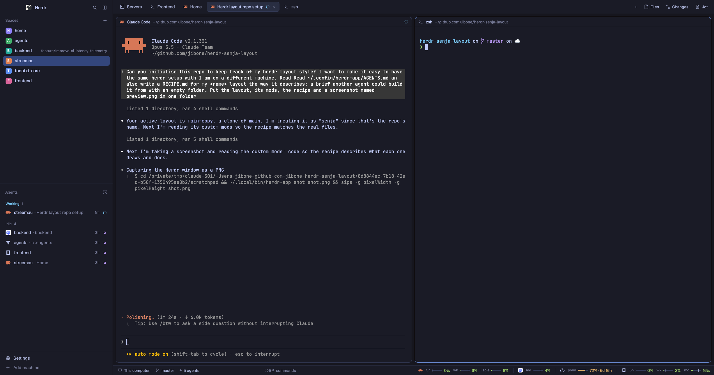

# Senja

Senja is Herdr's own `main` layout in Tokyo Night, with a few changes for working in an editor. A 268px sidebar holds your spaces and agents. The tab bar has its pills plus three toggles on the right: **Files**, **Changes** and **Jot**. Every pane is a rounded card with a header. Files opens a native file tree, and the tab's own Neovim pane opens with it. Changes opens gitview, a git panel with a full-height diff pane. Jot opens one free-text scratch pad that every space shares. The status bar shows the shipped workspace facts on the left. On the right it shows live usage meters for Claude Code, Codex, Copilot and OpenCode.

## What you see

Left to right, top to bottom. Sizes are logical px at zoom 1; the screenshot is zoom 1.2 on a 2x display. Colors are Tokyo Night theme names, with the hex in brackets.

- **Window:** there is no system title bar (`titlebar: none`). The macOS traffic lights sit at `[12, 16]`, over the sidebar's brand row. The root background is `canvas` (`#16161e`). A 1px `border` (`#343b58`) divider separates the sidebar from the work area.
- **Sidebar**, 268px wide (min 44, max 480, not drag-resizable), background `chrome` (`#1a1b26`). Top to bottom:
  - **Brand row**, 46px (the shipped `workspace-chrome`): the Herdr logo and "Herdr", plus search and sidebar-fold buttons. Dragging it moves the window.
  - **Spaces** (the shipped `spaces`, weight 1, min 90): a "Spaces" header with a +. Each space is a row with a colored letter avatar, its name and, dimmed on the right, its git branch. The active space has a `selected` (`#33467c`) pill.
  - **Agents** (the shipped `agents`, weight 1, min 90): an "Agents" header with a history clock. Agents are grouped by status (Working, Blocked, Done, Idle), each group with a count. A row shows the program icon, the space name, the dimmed tab title, the age (`3h`) and a status mark.
  - **Footer**, 69px (`workspace-chrome` with `{footer: true}`): Settings and Add machine.
- **Work area** (a column, not resizable):
  - **Tab bar**, 42px (`tabs-jot`), background `chrome` with a 1px `border` bottom line. Dragging it moves the window. Tabs are 29px pills: radius 7, text 12.8px, program icon 14px, names cut off at 170px. The active tab is `raised` (`#292e42`) with a `border` outline, `foreground` text and a close ×. The others are `chrome` with `muted` (`#a9b1d6`) text. On the right are a 26px **+**, then the **Files**, **Changes** and **Jot** pills (26px, text 12px, 14px icon). A pill is `selected` while its panel shows, else `chrome`/`muted`.
  - **Body** (a row, padding 8, gap 8):
    - **Panes** (`{tab: "active"}`): every pane is a card, even a lone one. A card has background `background` (`#1a1b26`), a 1px `border` (`accent` `#7aa2f7` when focused), radius 10 and 8px gaps. Terminal padding is `[14, 12]`. Each card has a 30px header on top that always shows. It is the shipped pane header: program icon, title, the folder dimmed, a status spinner, and split/zoom/close on hover. On Neovim and preview panes, the header also has a small bordered button at the right end.
    - **Side panel**, 300px (min 280, max 900), hidden at start. It is a stack of two slots. **Files** is herdr-nvim's tree: the tab's folder with git marks and LazyVim explorer keys. **Changes** is gitview's file list.
    - **Jot**, 420px (min 260, max 900), hidden at start. It is a card with radius 10, `background` fill and a 1px `border`. It has a 42px header with "Jot" in semibold and "one pad · every space" dimmed on the right. Below that is a soft-wrapped textarea in the terminal font (JetBrains Mono by default), 13px, with padding 14/12. The placeholder reads "Jot anything — one pad for every space, saved as you type."
  - **Status bar**, 28px (a row, not resizable):
    - `workspace-status` (weight 1): machine ("This computer"), branch, agent count, and `⌘⇧P commands` in the middle.
    - `usage-limits` (weight 2.2, min 130): right-aligned, text 11.8px. There is one group per provider (Claude, Codex, Copilot, OpenCode), separated by 1×14px dividers. A group shows the provider icon, then one segment per limit window (`5h`, `wk`, `Fable`, `mo`, `prem`). A segment is a dim label, a 30×4px bar with a pace tick, and the percent. The percent turns green, amber or red as the limit fills; when it gets tight, it also shows the time to reset (`72% · 6d 16h`).
- **Floating block** `herdr-nvim-sync`: an empty, sizeless block at the bottom-right edge. You never see it. It is herdr-nvim's controller.

## How it behaves

- **Agent status:** the colors come from the theme: working `#7dcfff`, blocked `#f7768e`, done `#9ece6a`, idle `#bb9af7`. In the agents list, working shows a spinner and idle a hollow ring. In the tab pills, working is a 12px spinning `workspace-chrome/spinner.svg` (900 ms a turn), and blocked or done is a 6px dot. Pane headers show the shipped status spinner.
- **Tabs:**
  - Click a tab to select it. Double-click to rename it (`tab.rename`). Drag one pill onto another to reorder (`tab.move`). Right-click opens the shipped `menu` popup.
  - The mouse wheel moves one tab per notch. A trackpad swipe moves one tab per ~20px, then one per 60px, at most one every 100 ms.
  - **+** opens the shipped `new-menu` (250×512) to start a terminal or an agent.
  - An agent's tab follows the agent's live title unless you named the tab.
- **Files** (pill, `cmd-e`): shows the side panel on Files. herdr-nvim's controller then opens the tab's Neovim pane, a full-height real `nvim` terminal backed by a per-tab daemon, beside the tree. Closing the panel closes that Neovim pane. The panel follows the tab: it is open on tabs that have a Neovim pane and closed on the rest. Other keys:
  - `cmd-o` picks a file from the agent's output.
  - `cmd-shift-e` reveals the current file in the tree and gives the tree the keyboard.
  - `q` or Esc in the tree gives the keyboard back.
  - `<leader>e` in Neovim hides only the tree.
- **Preview button** on the Neovim pane's header, when the open file is markdown, an image or an SVG: shows the file rendered in Neovim's place. On the preview pane, the button reads **Source** (or **nvim** for images) and swaps back.
- **Changes** (pill, `cmd-shift-g`): shows the side panel on gitview. Clicking a file, or moving onto it with `j`/`k`, opens its diff in a full-height diff pane at the tab's right edge. Enter opens the file in the tab's Neovim. Keys in the list:
  - `t` switches between a flat list and a tree.
  - `l` shows history, `n` shows notes, `?` lists every key.
  
  Keys in the diff pane:
  - `v` selects lines and `a` writes a review note on them.
  - `s`, `u` and `x` stage, unstage and discard.
  - `J`/`K` move to the next or previous file.
  - `m` switches between Diff and Preview.
  - `p` sends your notes to an agent's input. The `gitview-agents` dialog picks the agent.
  
  `cmd-g` opens gitview in a tab of its own instead: the diff on the left, the list on the right at 29%. Pressing it inside that tab closes it.
- **Jot** (pill, `cmd-shift-s`): toggles the jot block with `layout.toggle {id: "jot"}`. Text saves as you type to `<home>/data/jot/jot.txt`, so every space and window sees the same pad. When something else writes that file (an agent appending a note), the change appears in the pad unless you are mid-edit. Your typing always wins.
- **Per-space memory:** each space remembers whether the side panel was open and on which slot, and whether Jot was open. Switching spaces restores that space's choice.
- **Usage limits:** refetched every 5 minutes, and hourly for a provider that is not installed. Hovering opens a details panel (after 350 ms) where you choose what shows on the bar.
- `cmd-b` folds the sidebar to a rail. Dragging the brand row or the tab bar moves the window.

## Built from

- **Layout `layouts/senja.json`.** Root keys: `"type": "row"`, `"theme": "tokyo-night"`, `"preview": "layouts/senja.png"`, `"background": "canvas"`, `"terminal_padding": [14, 12]`, `"divider": {"width": 1, "color": "border"}`, `"titlebar": "none"`, `"traffic_lights": [12, 16]`. The tree:
  - `sidebar` column (268px, min 44, max 480, `chrome` background, `resizable: false`):
    - `brand`: `workspace-chrome`, 46px, `window_drag: true`.
    - `sidebar-lists` column: `spaces` and `agents` blocks, weight 1 each, min 90.
    - `sidebar-footer`: `workspace-chrome` with `{footer: true}`, 69px.
  - `work` column (`resizable: false`):
    - `tabs`: `tabs-jot`, 42px, `window_drag: true`.
    - `work-body` row (padding 8, gap 8):
      - `main`: `{tab: "active", pane: {...}}`. The pane frame has a header (`herdr-nvim-header` with props `{replaces: {mod: "pane"}}`, height 30, top, `reveal: "always"`), `background: "background"`, border 1 `border`, focus 1 `accent`, radius 10, gap 8, `lone: true`.
      - `panel` column (300px, min 280, max 900, `hidden: true`) holding the `panel-body` stack (`active: "files"`). The stack's children are `files` (`herdr-nvim`, props `{replaces: {mod: "files"}, panel_width: 300}`) and `changes` (`gitview`, props `{replaces: {mod: "changes"}}`).
      - `jot`: the `jot` mod, 420px, min 260, max 900, `hidden: true`.
    - `status-row` row (28px, `resizable: false`): `status` (`workspace-status`, weight 1) and `usage-limits` (weight 2.2, min 130).
  - `floating`: `herdr-nvim-sync`, a `herdr-nvim` block with `{role: "sync"}`, `edge: "bottom"`, `align: "end"`.

  The block ids `panel`, `panel-body`, `files`, `changes` and `jot` are part of the contract: the mods find their nodes by id.
- **Shipped mods used as-is:** `workspace-chrome`, `spaces`, `agents`, `workspace-status`, `new-menu`, `menu`. Assets: `mods/workspace-chrome/spinner.svg`, `mods/pane/close.svg`, `mods/files/file.svg`, `mods/changes/changes.svg`.
- **`tabs-jot`** (the person's own, MIT): a fork of the shipped `tabs`. It adds the Jot pill, which runs `layout.toggle {id: "jot"}` and appears only when the layout has a `jot` block. It also adds per-space memory of the jot block in localStorage `pads`, next to the shipped panel memory in `panels`. It reads shared `"workspace.panels"` to decide which of the Files and Changes pills show. Commands: `tab.select`, `tab.move`, `tab.rename`, `tab.close`, `tab.prev`, `tab.next`, `layout.select`, `layout.show`, `layout.hide`, `layout.toggle`, `window.*`. Its own assets are the Windows window-button SVGs.
- **`jot`** (the person's own, MIT): a `Textarea` over `data/jot/jot.txt`. It uses `readTextFile`, compare-and-swap `writeTextFile(file, text, expected)`, and a `watchFolder` loop (skipped under `checking()`). Only one write runs at a time, with the latest text first.
- **`herdr-nvim`** plus **`herdr-nvim-header`** (third-party, from herdr-nvim's `herdr-app/install.sh`):
  - One mod with several roles, chosen by props: the tree (the `files` slot), the controller (`{role: "sync"}`), a preview pane, dialogs, and the `mod.open:herdr-nvim` overlay.
  - It runs `mods/herdr-nvim/bin/herdr-nvim`, a launcher into `~/.local/share/herdr-nvim/app/<hash>/`, which needs Neovim installed.
  - It turns the shipped Files pill off when its `tree = "nvim"` mode is set (shared `herdr-nvim.files-button-off`).
  - The header is the shipped `pane` header copied in as `pane-base.js`, with the Preview/Source button added. That button runs `herdr-nvim.swap:<tab>:<file>`.
  - Commands: `herdr-nvim.pick`, `herdr-nvim.reveal`, `herdr-nvim.toggle`, `herdr-nvim.files`.
- **`gitview`** plus helpers **`gitview-diff`**, `gitview-sidebar`, `gitview-tab`, `gitview-agents`, `gitview-ask`, `gitview-keys`, `gitview-mark` and `gitview-tracing` (third-party):
  - The list and diff talk through shared state (`gitview.views`).
  - `gitview/config.json` names the `herdr-gitview` engine binary (`bin/herdr-gitview`, macOS arm64), `herdr-app` and `hc`. Commands go through `gitview.key:<k>`, `gitview.file:<path>` and `gitview-diff.key:<k>`.
  - It runs `git` through the engine and `nvim` through herdr-nvim.
- **`usage-limits`** (the person's own, github.com/jibone/herdr-limits, which has its own RECIPE.md): the status-bar meters.
  - Providers live in `providers/*.js`.
  - Shell helpers in `helpers/*.sh` ask each CLI for its usage: `claude` through a stream-json control request, `codex`, and `gh` for Copilot. OpenCode's numbers come from its SQLite database.
  - It uses `hc get` to read a terminal's session. It never reads a token.
- **`keys.json`:** `cmd-e` → `mod.open:herdr-nvim`, `cmd-o` → `herdr-nvim.pick`, `cmd-shift-e` → `herdr-nvim.reveal`, `cmd-shift-g` → `mod.open:gitview-sidebar`, `cmd-g` → `mod.open:gitview-tab`. In section `layout:senja`, `cmd-shift-s` → `layout.toggle {id: "jot"}`.
- **Theme `themes/tokyo-night.json`:** background `#1a1b26`, foreground `#c0caf5`, Tokyo Night ANSI colors, and panel colors as listed under What you see. Fonts are Herdr's defaults: JetBrains Mono 14 for terminals and Geist for the UI. The person runs zoom 1.2 with `appearance: dark` in settings.json.

## Watch out

- **Machine-specific files:**
  - `mods/herdr-nvim/bin/herdr-nvim` and `mods/gitview/config.json` contain absolute paths to `/Users/jibone/...`.
  - `bin/herdr-gitview` is a macOS arm64 binary.
  - On another machine, run herdr-nvim's installer, which installs the Neovim plugin into `~/.local/share/herdr-nvim` and rewrites the launcher. Then fix the three paths in gitview's `config.json`. Without these, the tree, the Neovim pane and gitview log errors, while the rest of the layout works.
- `herdr-nvim-header/pane-base.js` is a copy of the shipped `pane` header from Herdr 0.1.16. If Herdr's header moves on, recopy it, or the headers look dated.
- `tabs-jot` is a fork of the shipped `tabs` from 0.1.16 and is never updated. To pick up upstream fixes, re-clone `tabs` and re-apply the Jot changes (they are marked "The fork's addition").
- The **Files** pill only appears while shared `"workspace.panels"` includes `"files"`. herdr-nvim removes it in `tree = "nvim"` mode. The **Jot** pill only appears when a block with id `jot` exists.
- The side panel and Jot both start `hidden: true`. The first look at a space never forces them open; each space's choice is restored from then on.
- `usage-limits` shows a gauge icon and no meters until at least one provider CLI is installed and logged in.
- The floating `herdr-nvim-sync` block must stay. A hidden block's mod never renders, so the controller would stop working.
- Jot's file is `data/jot/jot.txt` under the app home. It is not in this folder: the pad's text stays on the machine.

## Done when

- `herdr-app check` passes for each folder in `mods/`.
- `herdr-app do layout.switch '{"name":"senja"}'` shows the layout with no `layout.error`. The sidebar is 268px wide, the tab bar 42px and the status bar 28px, in Tokyo Night.
- A lone terminal pane is a rounded card with a 30px header, and the focused card's border is `#7aa2f7`.
- The tab bar shows `+ Files Changes Jot` on the right.
- Clicking **Jot** (or `cmd-shift-s`) opens a 420px pad. Typing writes `data/jot/jot.txt`. Another space shows the same text, and an outside `echo hi >> data/jot/jot.txt` shows up in the pad.
- Clicking **Files** opens the 300px tree and the tab's Neovim pane together. Clicking it again closes both.
- Clicking **Changes** in a git repo lists changed files. Clicking one opens its diff pane.
- An agent that is working shows a spinner on its tab pill and in the agents list. When it finishes, the pill shows a green `#9ece6a` dot.
- With `claude` installed, the status bar's right side shows Claude's `5h` and `wk` meters.
